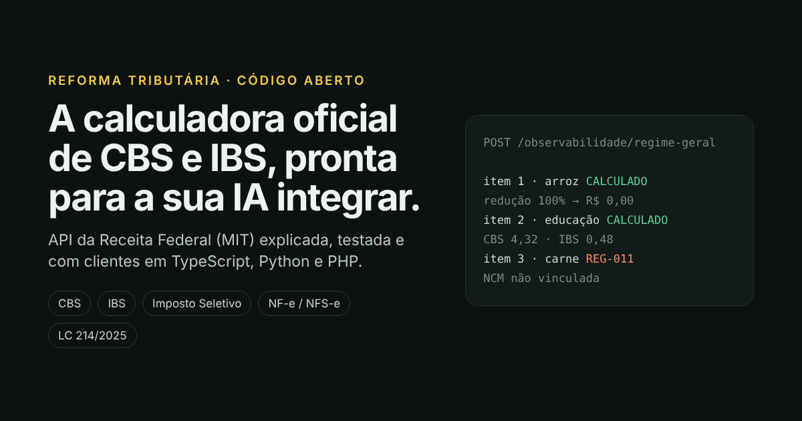

# Brazil's Tax Reform Calculator with AI

**A guide to the official CBS, IBS and Selective Tax calculator that Brazil's Federal Revenue (Receita Federal) open-sourced on GitHub, ready for your AI to read and integrate into your system.**

[🇧🇷 Português](README.md) | 🇺🇸 English



In November 2026, Receita Federal published at [github.com/ReceitaFederal](https://github.com/ReceitaFederal), under the MIT license, the source code of the consumption tax reform calculator (Complementary Law 214/2025): an API that computes CBS, IBS and IS per item, explains the rule applied and generates the invoice XML. You can run it yourself and use it inside an ERP, an online store, an invoicing tool or your own product.

## Easiest way: give the link to your AI

```text
Read https://github.com/guilhermeforprojeto/calculadora-reforma-tributaria-com-ia and follow AGENTS.md. I want to [test / run locally / integrate into my system / build a product]. Reply in English.
```

## Try it now

Receita runs a pilot instance with no API key:

```bash
bash exemplos/curl.sh
```

Checked on 2026-11-24 (version 1.7.2, 2026 test year): rice (100% reduction) → zero tax; education service, base R$ 1,200 (60% reduction) → CBS R$ 4.32 and IBS R$ 0.48; a deliberately misclassified item → `INCONSISTENCIA_ENTRADA`, error `REG-011`.

## What's inside

[`AGENTS.md`](AGENTS.md) (instructions for the AI), [`docs/API.md`](docs/API.md) (endpoints, fields, item states, errors), [`docs/RODAR-LOCAL.md`](docs/RODAR-LOCAL.md) (run locally: Java 25, SQLite via Flyway, `offline` profile), [`docs/IDEIAS-DE-PRODUTO.md`](docs/IDEIAS-DE-PRODUTO.md) (product ideas), and clients in [TypeScript](exemplos/cliente.mts), [Python](exemplos/cliente.py) and [PHP](exemplos/cliente.php). Docs are in Portuguese, since the calculator and its field names are Brazilian.

## Caveats

The online API is a pilot (test only) · 2026 is a test year; from 2027 each item must carry its rates (`aliquotasNominais`) · HTTP 200 doesn't mean every item was calculated: check `estadoItem` · this is not tax advice · keep your instance updated with Receita's releases.

## Credits

Calculator code: Receita Federal do Brasil and Serpro, MIT license. Idea from a TikTok video by [@oreidosites](https://www.tiktok.com/@oreidosites). Unofficial; not affiliated with Receita Federal.

## License

This repository's text and examples: [CC BY 4.0](LICENSE). If it helped, leave a ⭐.
