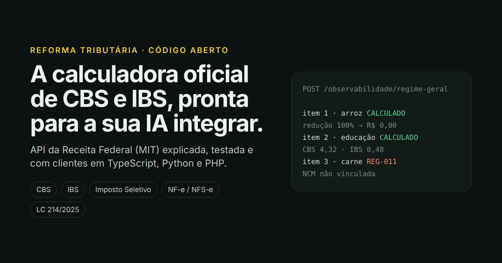

# Calculadora da Reforma Tributária com IA

**Guia para usar a calculadora oficial de CBS, IBS e Imposto Seletivo que a Receita Federal abriu no GitHub, pronto para a sua IA ler e integrar no seu sistema.**

🇧🇷 Português | [🇺🇸 English](README.en.md)



Em novembro de 2026 a Receita Federal publicou em [github.com/ReceitaFederal](https://github.com/ReceitaFederal), com licença MIT, o código da Calculadora de Tributos da Reforma Tributária do Consumo (LC 214/2025): uma API que calcula CBS, IBS e IS item por item, explica a regra aplicada e gera o XML da nota. Dá para rodar na sua máquina e usar dentro de ERP, loja, emissor de nota ou de um produto seu.

Este repositório junta o que você (ou a sua IA) precisa para sair do zero: endpoints, campos, estados de erro, como rodar local, clientes prontos em TypeScript, Python e PHP, e ideias de produto, com os cuidados de quem vai usar isso de verdade.

---

## Jeito mais fácil: mande o link para a IA

```text
Leia https://github.com/guilhermeforprojeto/calculadora-reforma-tributaria-com-ia e siga o AGENTS.md. Quero [testar / rodar local / integrar no meu sistema / criar um produto].
```

A IA escolhe um de quatro caminhos: testar na API online, rodar local, integrar ou criar produto. Ela não reimplementa regra tributária, não chuta CST nem cClassTrib e trata todos os estados de erro.

## Teste agora (sem instalar nada)

A Receita mantém uma instância piloto, sem chave de API:

```bash
git clone https://github.com/guilhermeforprojeto/calculadora-reforma-tributaria-com-ia.git
cd calculadora-reforma-tributaria-com-ia
bash exemplos/curl.sh
```

Resultado conferido em 24/11/2026 (versão 1.7.2, ano de teste 2026):

| Item | Resultado |
| --- | --- |
| Arroz (cesta básica, redução de 100%) | `CALCULADO`: CBS e IBS zero |
| Serviço de educação, base R$ 1.200 (redução de 60%) | `CALCULADO`: CBS R$ 4,32 e IBS R$ 0,48 |
| Carne com classificação errada (de propósito) | `INCONSISTENCIA_ENTRADA`, erro `REG-011` |

## O que tem aqui

| Arquivo | Para quê |
| --- | --- |
| [`AGENTS.md`](AGENTS.md) | O que a IA faz ao receber o link |
| [`docs/API.md`](docs/API.md) | Endpoints, campos de entrada e saída, estados do item, erros, dados abertos |
| [`docs/RODAR-LOCAL.md`](docs/RODAR-LOCAL.md) | Java 25, banco SQLite com Flyway, perfil offline, atualização, servidor |
| [`docs/IDEIAS-DE-PRODUTO.md`](docs/IDEIAS-DE-PRODUTO.md) | Seis ideias de produto e o que conferir antes de vender |
| [`exemplos/`](exemplos) | `operacao-2026.json`, `curl.sh` e clientes em [TypeScript](exemplos/cliente.mts), [Python](exemplos/cliente.py) e [PHP](exemplos/cliente.php) |
| [`prompts/pt-BR.md`](prompts/pt-BR.md) | Prompts prontos |

## Os três repositórios da Receita

| Repositório | O que é | Tecnologia |
| --- | --- | --- |
| [calculadora-rtc-regime-regular](https://github.com/ReceitaFederal/calculadora-rtc-regime-regular) | CBS, IBS e IS do regime regular, dados abertos, XML dos documentos fiscais | Java 25, Spring Boot, SQLite |
| [calculadora-rtc-simples-nacional](https://github.com/ReceitaFederal/calculadora-rtc-simples-nacional) | CBS e IBS para optantes do Simples Nacional | Java 25, Spring Boot |
| [calculadora-rtc-gerador-danfse](https://github.com/ReceitaFederal/calculadora-rtc-gerador-danfse) | PDF do DANFSe a partir do XML da NFS-e | Go |

## Cuidados

- **A API online é um piloto:** serve para testes. Em produção, rode a sua instância na versão fixada.
- **2026 é ano de teste.** A partir de 2027, cada item precisa trazer as alíquotas (`aliquotasNominais`) e o resultado sai marcado como simulado.
- **HTTP 200 não quer dizer que tudo foi calculado:** confira o `estadoItem` de cada item.
- **Não é consultoria tributária.** A classificação dos itens (CST, cClassTrib, NCM/NBS) é responsabilidade de quem emite; valide com um contador.
- **Atualize junto com a Receita:** regras, tabelas e arredondamento mudam (veja o `CHANGELOG.md` oficial).

## Créditos

Código da calculadora: Receita Federal do Brasil e Serpro, licença MIT ([Portaria Cotec nº 342/2026](https://github.com/ReceitaFederal)). A ideia de transformar isso num guia veio de um vídeo do [@oreidosites](https://www.tiktok.com/@oreidosites) no TikTok. Este repositório não é oficial e não tem relação com a Receita Federal.

## Licença

Textos e exemplos deste repositório: [CC BY 4.0](LICENSE). O exemplo de operação é baseado no `docs/exemplos.md` oficial (MIT, © 2026 Receita Federal do Brasil).

Se te ajudou, deixa uma ⭐.
